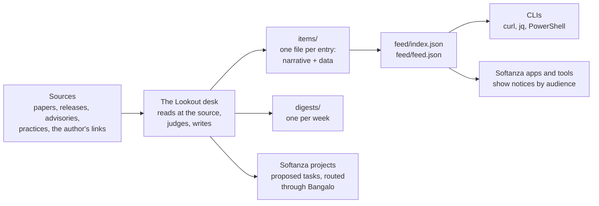

# Lookout

**A public watch on what is changing in AI, read from Softanza's point of view, with a feed that any program can read.**

**Open it: [Lookout Radar](https://mayouni.github.io/lookout/)**, the week on a radar, with each signal to watch, to build
from and to learn from, for developers, learners, maintainers and users.

A lookout is the one who keeps watch and calls out what is coming, in time for the others to act.

AI moves every week. New projects appear, papers change how we think, labs ship features, companies change their
practices, and security researchers find holes and fixes. Lookout keeps one place where each of these is read at its
source, judged against what [Softanza](https://github.com/mayouni/stzlib) builds, and turned into something useful:

- **something to learn**: where Softanza stands, and what it should take from others;
- **something to do**: a task proposed to the Softanza project it concerns;
- **something to tell**: a short notice for the people it affects, whether they are developers, users, learners or
  maintainers.

The day this becomes a feature of the stack itself, an assistant such as Aicha will read this feed and say: *there is
a new development you should know about, here is what it means for you.* Until then, the feed is open to any program
that wants to do the same.

## How it works



**Each entry has two forms in the same file.** An item is a Markdown page that people read. It opens with a JSON
block that programs read. The feed is generated from those blocks. So the narrative and the data cannot drift apart,
because they are one file.

## Reading it as a person

- [`digests/`](digests/): one page per week, the week's entries in a few paragraphs.
- [`items/`](items/): every entry, by year. Each one says what happened, why it matters to Softanza, and what we do
  about it, with its sources.
- [`docs/METHOD.md`](docs/METHOD.md): how an entry is judged, and what never goes into this repository.

## Reading it as a program

The feed is a plain JSON file, refreshed whenever an entry changes:

    https://raw.githubusercontent.com/mayouni/lookout/main/feed/index.json

```sh
FEED=https://raw.githubusercontent.com/mayouni/lookout/main/feed/index.json

# the five newest entries
curl -s $FEED | jq -r '.items[:5][] | "\(.date)  \(.level)  \(.title)"'

# what a developer should act on since the first of the month
curl -s $FEED | jq -r '.items[]
  | select(.date >= "2026-11-01")
  | select(.audiences | index("developer"))
  | select(.level == "action" or .level == "urgent")
  | "\(.id)  \(.notice.developer)"'
```

```powershell
$feed = Invoke-RestMethod https://raw.githubusercontent.com/mayouni/lookout/main/feed/index.json
$feed.items | Where-Object { $_.audiences -contains 'learner' } | Select-Object date, title
```

There is also a [JSON Feed](https://www.jsonfeed.org/) at `feed/feed.json` for ordinary feed readers. The contract,
including every field, is [`docs/FEED.md`](docs/FEED.md).

## Showing notices inside an application

An application built with Softanza, or any other, can show Lookout's notices to its own people. The rules are short,
and they exist because a remote feed that shows text to users is itself something to defend:

1. Show only the notice written for your audience (`notice.developer`, `notice.user`, `notice.learner`,
   `notice.maintainer`), as plain text, never as HTML.
2. Link only to the entry's own page (`url`), never straight to a source.
3. Hide an entry after its `review_by` date, or when its status is `declined` or `superseded`.
4. Never act on an entry's `actions`. They are proposals to Softanza's maintainers, not instructions to software.

The full rules are in [`docs/FEED.md`](docs/FEED.md#showing-a-notice).

## The words used

| Field | Values | Meaning |
|---|---|---|
| `kind` | paper, release, feature, practice, security, regulation, market, idea | what the entry is about |
| `stance` | adopt, learn, correct, defend, watch, decline | Softanza's position on it |
| `level` | info, advice, action, urgent | how much it asks of the reader |
| `audiences` | developer, user, learner, maintainer | who it is written for |
| `status` | new, analysed, routed, done, declined, superseded | where it stands |
| `confidence` | read, reported, claimed | read at the source; reported by someone else; a figure the vendor claims for itself |

## Status

Opened on 2026-11-08. Lookout surveys every week and publishes a digest, entries and a signed feed:

- the feed carries an SSH signature beside each file, so an application checks it before showing a notice
  ([`docs/FEED.md`](docs/FEED.md#the-signature));
- a Softanza command that reads the feed for its user's audience and level is proposed to stzlib in
  [`docs/READER.md`](docs/READER.md);
- Softanza's assistant reads the feed aloud and drafts the work it proposes, leaving every action to a person, as
  proposed in [`docs/ASSISTANT.md`](docs/ASSISTANT.md).

## Contributing

Open an issue with a link and one line about why it matters. The desk reads it at the source and answers with an
entry, or with a line saying why it was not kept.

MIT licence, see [LICENSE](LICENSE).
