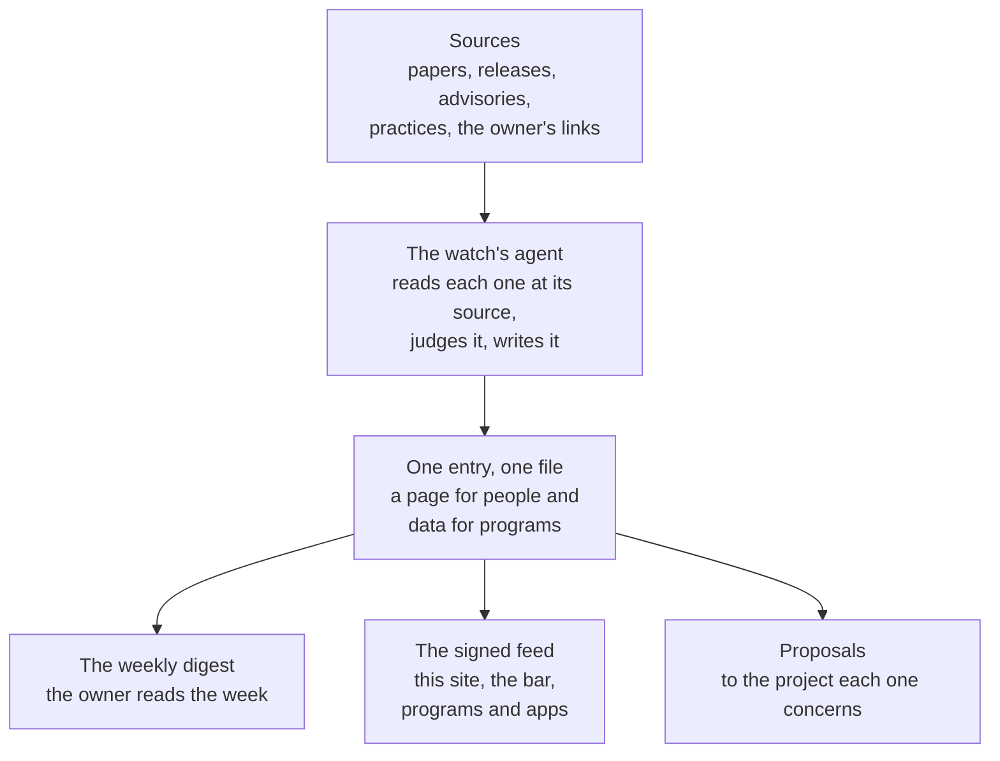

# Method -- how an entry is made

Every signal on this site is made the same way: read at its source, judged from Softanza's point of view,
written once for people and for programs, then signed and published. This page follows that path step by step,
and says why the radar highlights only a few signals each week.

## How it flows



Everything starts from a source read in full, and everything a reader sees comes from one file per entry. The feed is
generated from those files and signed, so a page, a program and a notice in an application all say the same thing.

## What is watched

Anything in AI that can change what Softanza builds, how it builds it, or how it protects the people who use it:

- **projects**: new libraries, languages, runtimes, agents, tools;
- **papers**: results that change how we think about programming, learning, models or safety;
- **features**: what the labs and the tool makers ship;
- **practices**: how teams and companies work, sell, charge and govern with AI;
- **security**: vulnerabilities, attacks and fixes, in models, agents, tool protocols and supply chains;
- **regulation and standards** that reach software like Softanza;
- **ideas** the author brings, as a link or a sentence.

## Six steps from a link to an entry

1. **Read it at the source.** Not a headline, not a summary of a summary. If only a second-hand account can be had,
   the entry says so (`confidence: reported`). A number a vendor gives about its own product is written as the
   vendor's claim (`confidence: claimed`), never as a fact.
2. **Say what happened, without judging.** That is the `summary`, two or three sentences.
3. **Take a stance.** Softanza reads every development for what it can **learn**, **adopt** or **correct**, and for
   what it must **defend** against. Too early to say is **watch**, with a date to look again. Considered and refused
   is **decline**, with the reason, and the entry is kept so that nobody analyses it twice.
4. **Weigh it.** `relevance` says how much it touches Softanza. `level` says how much it asks of the reader.
   `urgent` is kept for a security issue that affects Softanza's users now.
5. **Write one sentence per audience.** A developer, a user, a learner and a maintainer need different sentences,
   and some of them need none. Write only the ones that are owed.
6. **Propose the work.** Each action names the Softanza area it concerns and says, verb first, what is proposed. The
   desk routes it to that project through Bangalo, Softanza's coordination system, and moves the action's `state`
   as the project answers. The repository it lands in decides how to do it, and whether to do it.

## The entry's page

````markdown
# <title>

```json
{ the data block: see docs/FEED.md }
```

## What happened
## Why it matters to Softanza
## What we do
## Sources
## Corrections          (only when the entry has been corrected)
````

The narrative may be longer than the data, never different from it.

## Corrections

An entry is corrected in place. Its `updated` field takes the day, and a line under **Corrections** says what
changed and who found it. Nothing is changed silently, and an entry is never deleted: a wrong one becomes
`superseded` by its replacement.

## What never goes into this repository

This repository is public. So it never holds:

- a private person's name, a client, or anything about either;
- anything said in a private conversation, unless its author asked for it to be published;
- a key, a token, a password, or a path on the machine that runs the desk;
- a source that was not read, a date that was not checked, or a quotation longer than a short phrase;
- a vendor's figure presented as Softanza's own measurement.

## The week

Once a week the desk surveys its sources (`docs/SOURCES.md`) and the author's links (`inbox/LINKS.md`), writes the
week's entries and a digest (`digests/YYYY-Www.md`), and regenerates the feed. `docs/WEEKLY.md` is the exact
instruction a scheduled run follows. Depth beats breadth: a week with four entries read properly is better than a
week with twenty headlines.

## The radar highlights a few

The radar on the site highlights at most seven signals a week (`watch.radar_limit` in `lookout.yaml`). It chooses
them in a fixed order: first what a signal asks of its reader (to do now, to do, to consider, to know), then how much
it touches Softanza, then the newest. Every signal of the week stays in the list beside the radar, in All signals, in
the digest and in the feed.

The reason is attention. A radar earns its place by pointing: a few dots, each one worth a look, say where to look
first. Twenty dots say that everything matters, which tells a reader nothing. The list is the whole week; the radar is
where the week begins.
