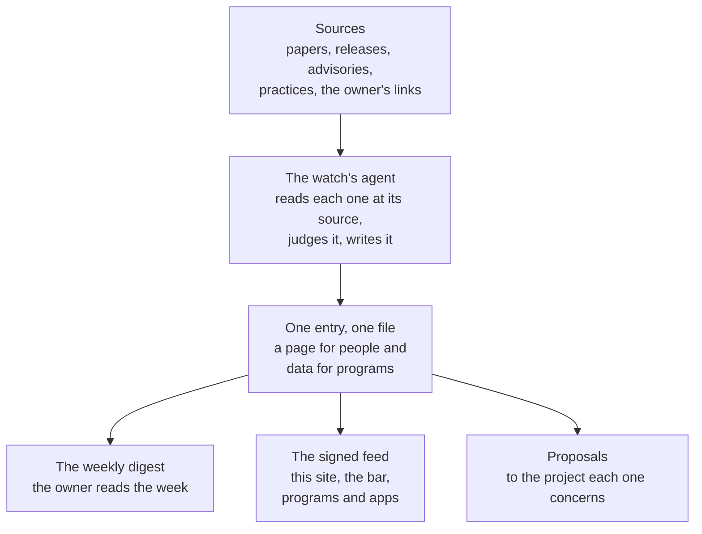

# Method -- how an entry is made

Every signal on this site is made the same way: read at its source, judged from Softanza's point of view,
written once for people and for programs, then signed and published. This page follows that path step by step,
and says why the radar highlights only a few signals each week.

## How it flows



- **One source, read in full,** starts every entry.
- **One file per entry** is where everything a reader sees comes from.
- **One signed feed** is generated from those files, so a page, a program and a notice in an application all say the
  same thing.

## What is watched

Anything in AI that can change what Softanza builds, how it builds it, or how it protects the people who use it:

- **projects**: new libraries, languages, runtimes, agents, tools;
- **papers**: results that change how we think about programming, learning, models or safety;
- **features**: what the labs and the tool makers ship;
- **practices**: how teams and companies work, sell, charge and govern with AI;
- **security**: vulnerabilities, attacks and fixes, in models, agents, tool protocols and supply chains;
- **regulation and standards** that reach software like Softanza;
- **ideas** the author brings, as a link or a sentence.

## Six steps from a link to an entry

1. **Read it at the source.** Never a headline. A second-hand account is marked `confidence: reported`; a vendor's
   figure about its own product, `confidence: claimed`.
2. **Say what happened, without judging.** That is the `summary`, two or three sentences.
3. **Take a stance.** **Learn**, **adopt**, **correct** or **defend**; **watch** with a date to look again; or
   **decline** with the reason, kept so that nobody analyses it twice.
4. **Weigh it.** `relevance` says how much it touches Softanza. `level` says how much it asks of the reader.
   `urgent` is kept for a security issue that affects Softanza's users now.
5. **Write one sentence per audience.** A developer, a user, a learner and a maintainer need different sentences,
   and some of them need none. Write only the ones that are owed.
6. **Propose the work.** Each action names the area it concerns and says, verb first, what is proposed. The project
   it lands in decides how to do it, and whether.

## The entry's page

````markdown
# <title>

```json
{ the data block: see docs/FEED.md }
```

## What happened
## Why it matters to Softanza
## What we do
## Sources
## Corrections          (only when the entry has been corrected)
````

The narrative may be longer than the data, never different from it.

## Corrections

- **In place.** An entry is corrected where it stands, and its `updated` field takes the day.
- **Never silently.** A line under **Corrections** says what changed and who found it.
- **Never deleted.** A wrong entry becomes `superseded` by its replacement.

## What never goes into this repository

This repository is public. So it never holds:

- a private person's name, a client, or anything about either;
- anything said in a private conversation, unless its author asked for it to be published;
- a key, a token, a password, or a path on the machine that runs the desk;
- a source that was not read, a date that was not checked, or a quotation longer than a short phrase;
- a vendor's figure presented as Softanza's own measurement.

## The week

- **Survey.** Once a week the desk reads its sources (`docs/SOURCES.md`) and the author's links (`inbox/LINKS.md`).
- **Write.** It writes the week's entries and a digest (`digests/YYYY-Www.md`), then regenerates the feed.
- **Follow one instruction.** `docs/WEEKLY.md` is the exact instruction a scheduled run follows.
- **Depth beats breadth.** Four entries read properly are worth more than twenty headlines.

## The radar highlights a few

- **At most seven a week,** set by `watch.radar_limit` in `lookout.yaml`.
- **Chosen in a fixed order:** what a signal asks of its reader (to do now, to do, to consider, to know), then how
  much it touches Softanza, then the newest.
- **Nothing is hidden.** Every signal of the week stays in the list beside the radar, in All signals, in the digest
  and in the feed.
- **The reason is attention.** A few dots, each worth a look, say where to look first; twenty say that everything
  matters, which tells a reader nothing.
